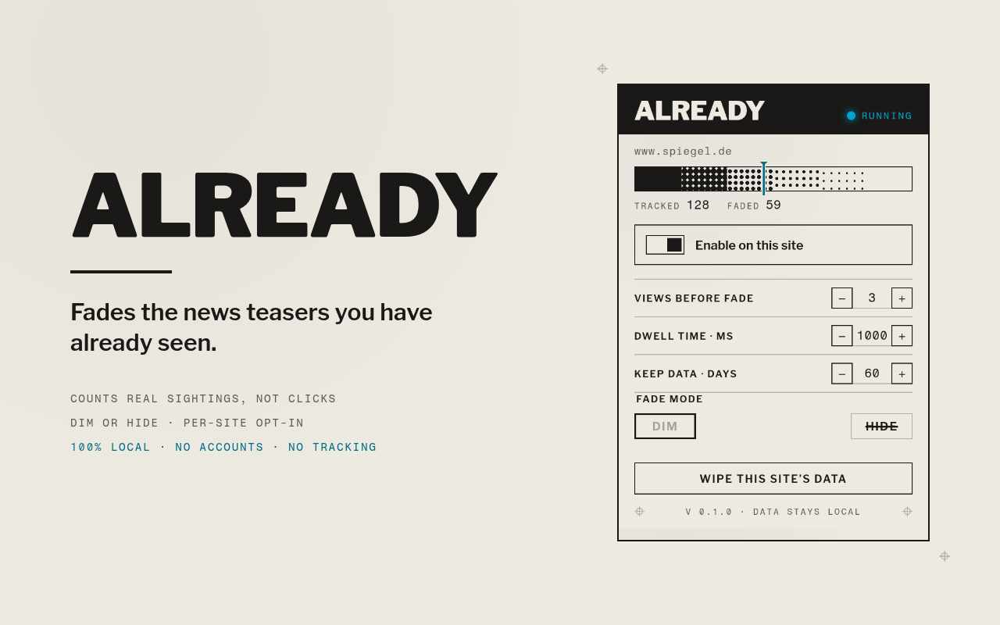
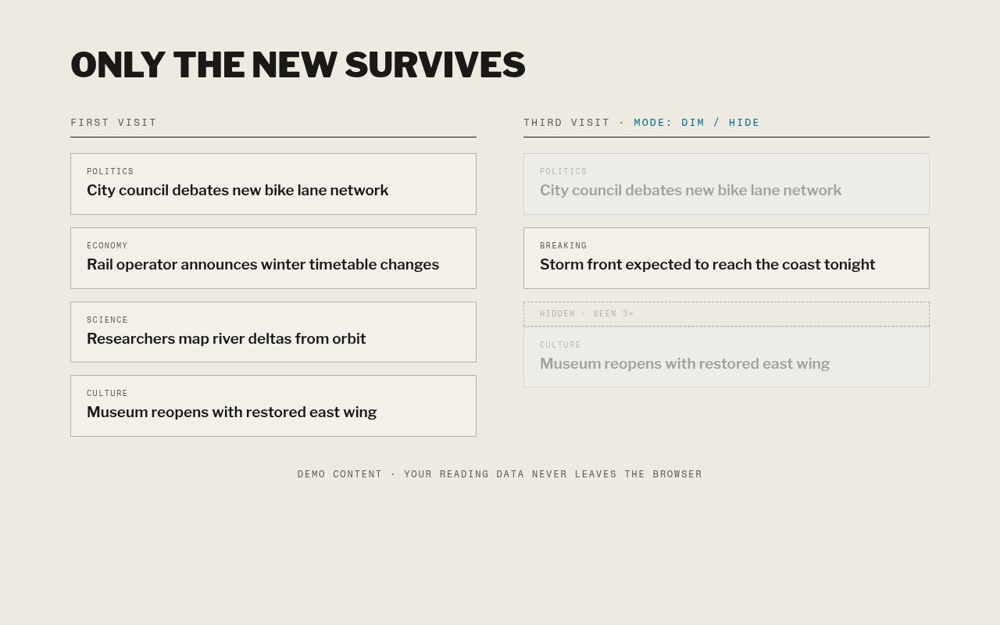

# Already

**Fades the news teasers you have already seen.**

Scanning the same news homepage all day means re-reading the same
headlines over and over. Already remembers what you actually saw
and fades it out — so only the new survives.

## How it works

- A teaser counts as **seen** only when it was really on screen:
  at least 50% visible for a configurable dwell time (default 1s).
  Flick-scrolling past does not count.
- After N sightings without a click (default 3), the teaser is
  **dimmed** — hover restores it — or **hidden** entirely.
- Articles you click or open fade immediately.
- Changing settings restyles open pages instantly.

## Private by design

- Runs **only on sites you enable**, one by one. Disabling a site
  revokes its permission again.
- Everything lives in `chrome.storage.local`. No accounts, no
  servers, no analytics, **zero network requests**.
- Data expires after a configurable retention period (default
  60 days). One click wipes a site's data.

## Install

**Chrome Web Store:** coming soon.

**From source:**

1. Clone this repo.
2. Open `chrome://extensions`, enable Developer mode.
3. "Load unpacked", select the repo folder.
4. Open a news site, click the Already icon, enable the site.

Works on Chrome, Brave, Edge, and other Chromium browsers (MV3).

## Settings

| Setting | Default | Meaning |
|---|---|---|
| Views before fade | 3 | Sightings without a click before fading |
| Dwell time | 1000 ms | How long a teaser must be visible |
| Fade mode | Dim | Dim (hover restores) or hide |
| Keep data | 60 days | Retention before entries expire |

## Development

- Vanilla JS, Manifest V3, no build step, zero dependencies.
- Pure logic lives in `lib.js`; tests: `node --test`
- Manual fixture: `python3 -m http.server 8000 --directory test`,
  then enable Already on `http://localhost:8000/fixture.html`.
- Package for the store: `bash scripts/package.sh` → `dist/*.zip`
- CI runs tests on push; tagging `v*` attaches a release zip.

## Design

The popup follows an "ink density" visual world: articles are
ink, repeated exposure drains it. A halftone gauge shows tracked
and faded counts per site. Fonts (Libre Franklin, Fragment Mono)
are bundled locally. See `DESIGN.md` and
[docs/superpowers/specs](docs/superpowers/specs/2026-08-31-already-design.md).
